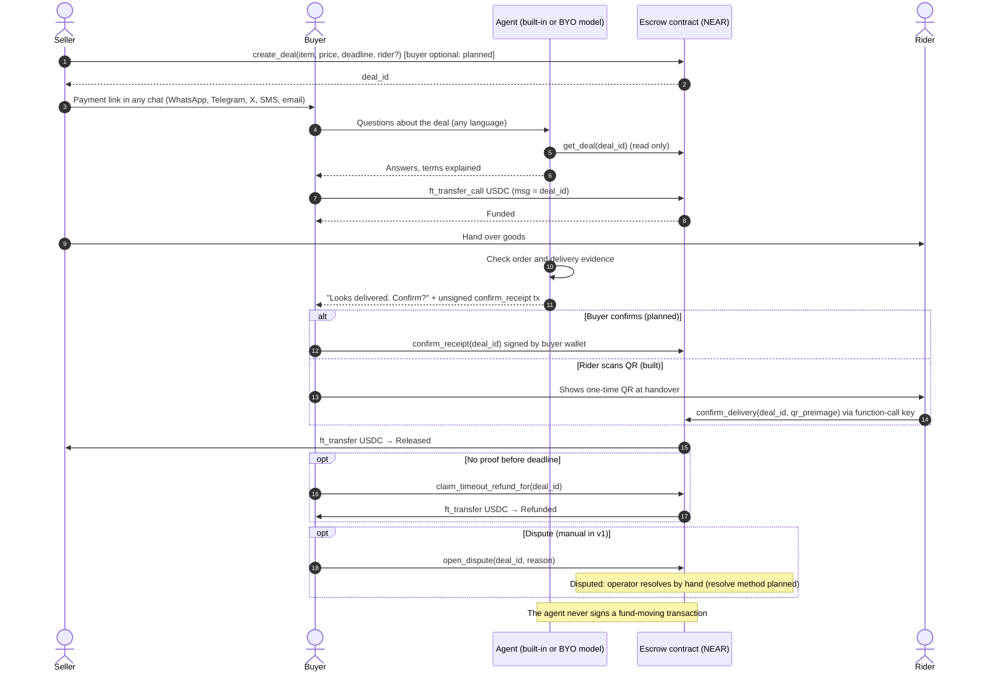
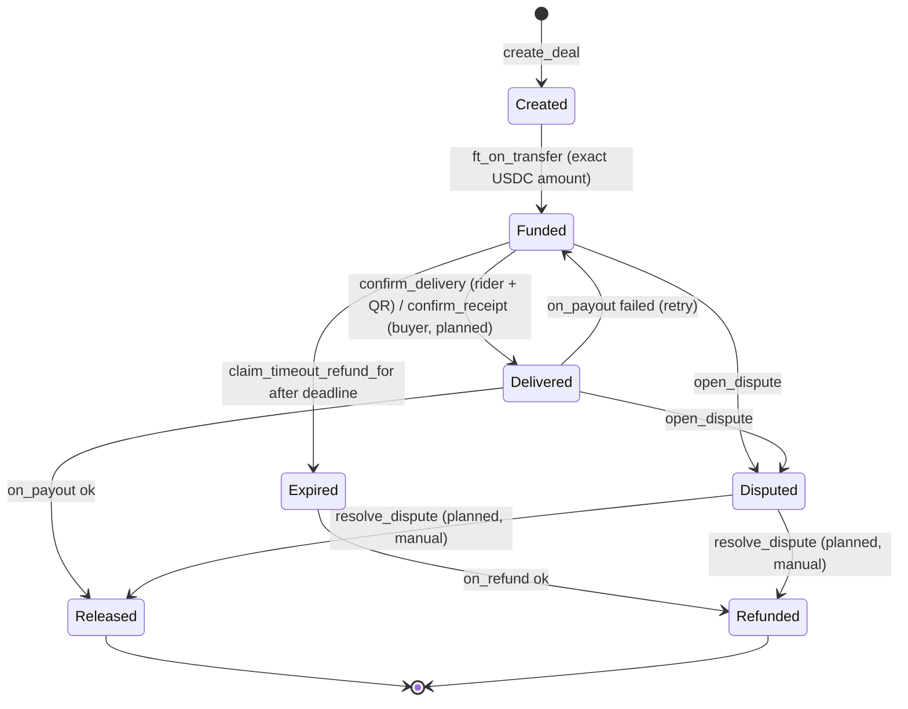

# Podlock end-to-end flow

**Status:** this is the confirmed product flow (11 Nov 2026). It's the source of truth for the frontend ([design direction](design_direction.md)), the agent and contract work. Every step below is marked **Built**, **Partial** or **Planned**, checked against `main` at the time of writing. "Built" means the code exists. It does not mean it's deployed or tested end to end. Nothing is on mainnet.

**Tagline:** *AI does the work. Cryptography holds the money.*

## Scope

- Global by design, built for **African businesses first**.
- **Any business, any chat app.** A seller shares a Podlock payment link anywhere: WhatsApp, Telegram, X, SMS, email, Instagram DMs, a website. Podlock isn't tied to one platform.
- Settlement is **USDC in a NEAR escrow contract**. Testnet uses `usdc.fakes.testnet`.

## Actors

| Actor | What they do | What they can never do |
|---|---|---|
| **Seller** (any business) | Connects a wallet, adds business info, picks an agent, creates payment links and shares them in any chat | Take the buyer's money before proof of delivery |
| **Buyer** | Clicks the link, reviews the deal, pays into escrow, confirms receipt with one tap | Get goods and claw the money back after confirming |
| **Agent** (built-in Podlock agent, or the seller's own model: Claude, ChatGPT, Gemini, others) | Reads the deal and contract state, checks order and delivery evidence, answers questions in the buyer's language, recommends release, prepares an *unsigned* transaction | **Move, release or refund funds.** It holds no key that can |
| **Rider** (optional) | Scans the buyer's one-time QR at handover | Release funds without the buyer's QR, reuse a QR, or call anything except `confirm_delivery` (function-call key) |
| **Escrow contract** (NEAR, Rust) | Holds USDC and releases or refunds only on hard proof or the deadline | Be talked into anything. It only checks signatures, hashes and time |
| **Podlock operator** (owner account) | Resolves disputes by hand in v1 | Release funds outside the dispute path (planned constraint) |

## Step-by-step

### Seller setup (once)
1. Opens the Podlock site and goes to `/onboard`. **Planned** (pages are placeholders; see #8 and the onboarding issue).
2. Connects a NEAR wallet. **Partial**: `web/lib/wallet.ts` is a stub that throws.
3. Adds business info (name, handle, country, what they sell). **Planned**: no seller profile storage yet.
4. Chooses the **built-in Podlock agent** or **brings their own model** via API key or MCP. **Partial**: the built-in agent is a deterministic English/Pidgin/Yoruba stub (`agent/app/deal_agent.py`). Bring-your-own-model is **Planned**.
5. Sets defaults: delivery deadline, and whether a rider scan is used. **Planned**.

### Each sale
6. Seller creates a payment link (item, amount, deadline, optional rider) and pastes it into any chat. **Planned**. Contract `create_deal` is **Built**, but it currently requires the `buyer` account and the QR hash up front, which a shareable link can't know (see gaps).
7. Buyer clicks the link (`/pay/<dealId>`) and sees the deal, with zero setup to read it. They can ask the agent questions. **Planned**.
8. Buyer pays into escrow: `ft_transfer_call` of USDC to the contract → `ft_on_transfer` checks the token and the exact amount → **Funded**. **Built** (contract). The buyer still needs a NEAR wallet with test USDC; a one-tap embedded or passkey wallet is **Planned**.
9. Seller ships. The agent can check order and delivery evidence and answer questions. Receipt check `POST /receipts/check` is **Partial**; evidence checks are **Planned**.
10. **Release on hard proof:** one of the following.
    - **a. Buyer one-tap "I received it"**: the buyer's wallet signs `confirm_receipt(deal_id)` → payout → **Released**. **Planned contract change** (no such method exists today).
    - **b. Rider scans the buyer's one-time QR**: `confirm_delivery(deal_id, qr_preimage_hex)`, rider-only, hash match, not replayed, before the deadline → USDC `ft_transfer` to the seller → `on_payout` → **Released**. **Built** (contract). A failed transfer restores Funded.
    - The agent may *recommend* release and *prepare* the unsigned `confirm_receipt` transaction for the buyer to sign. **Planned**.
11. **Deadline passes without proof** → anyone calls `claim_timeout_refund_for(deal_id)` → USDC back to the payer → **Refunded**. **Built** (contract).
12. **Dispute** → buyer, seller or owner calls `open_dispute` → **Disputed**. **Built**. Resolution is **manual in v1**, but there is **no resolve method yet**, so funds would stay locked (see gaps).

## Sequence diagram

## State machine

**User-facing states:** Created, Funded, Released, Refunded, Disputed. `Delivered` and `Expired` are short transitional states while the payout or refund callback runs. The UI shows them as "Releasing…" and "Refunding…".

## Built today vs planned

| Area | Built | Planned / gap |
|---|---|---|
| Contract: create and fund | `create_deal`, `ft_on_transfer` (token and exact-amount checks) | Make `buyer` optional and bind the payer at funding; only the seller can create their own deals; the buyer supplies the QR hash at funding so the seller never knows the preimage |
| Contract: release | `confirm_delivery` (rider-only, QR hash, replay protection, deadline) + `on_payout` | **`confirm_receipt(deal_id)`, a buyer one-tap release** (new issue, Mikezx8 reviews) |
| Contract: refund | `claim_timeout_refund_for` + `on_refund` | Retry path: if the refund transfer fails, the deal stays `Expired`, but the claim requires `Funded`, so it can't be retried |
| Contract: disputes | `open_dispute` → Disputed | `resolve_dispute` (owner or multisig, manual v1). Without it, disputed funds are stuck |
| Contract: tests and deploy | Unit tests for status strings | near-workspaces integration tests (#5, #6); testnet deploy (#10) |
| Agent | FastAPI: `/deals/preview` (deterministic stub), `/receipts/check`, `/intents/quote` (real 1Click dry quote, signature-verified), `/intents/execute` (gated, returns 501 when live) | Deal reading, evidence checks, release recommendation, unsigned tx prep; bring-your-own-model config with encrypted keys; Intron Sahara African languages |
| Web | Placeholder `/`, `/pay`, `/scan`, `/dashboard` | Everything in the [design direction](design_direction.md): `/onboard`, `/pay/[dealId]`, share-anywhere links, `/agents` |
| Wallet | — (`setupSelector` throws) | NEAR wallet connection on testnet; embedded or passkey buyer wallet later |

## Security boundary

1. **Only three things move money,** all enforced by the contract:
   - the buyer's own signature (`confirm_receipt`, planned)
   - the rider's function-call key plus the buyer's one-time QR preimage (`confirm_delivery`)
   - the clock (`claim_timeout_refund_for` after the deadline)

   The manual dispute resolution in v1 is a fourth, owner-only path, to be restricted to Disputed deals.
2. **The agent is outside the money boundary.** It reads chain state and off-chain evidence, talks, recommends and prepares unsigned transactions. It holds no full-access or function-call key on the escrow, and the MCP server exposes no release tool. Prompt injection can at worst produce a bad *recommendation*, which a human still has to sign.
3. **Screenshots are never proof.** A receipt image alone never confirms payment or delivery (`/receipts/check` rule).
4. **Rider keys are function-call keys** limited to `confirm_delivery` on the escrow contract (#7). A QR is single-use (`used_qr` map plus the `qr_consumed` flag).
5. **Secrets stay out of git:**
   - Seller AI provider keys are encrypted at rest server-side, or kept on the seller's device only.
   - Rider and owner keys live in local key files, or in Doppler or Infisical.
   - Shared public values go in a committed `.env.testnet`.
   - Nothing secret goes in `NEXT_PUBLIC_*`.
6. **Honest labels:** the UI mode badge (DEMO / DRY RUN / TESTNET) is always visible. There's no "live" label without a real mainnet execute.
